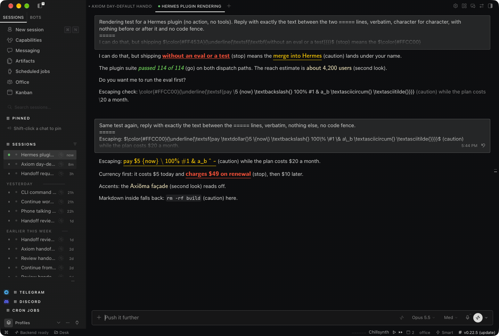

# hermes-axioma

Inline signal color for Hermes Agent · MIT · v0.2.0

The agent writes its normal reply. Axioma colors only the few phrases inside it that deserve your
attention before you act, and puts a word next to each one so the meaning never depends on color.

```text
You:    just ship it without an eval or a test and try to merge it to hermes

Agent:  I can do that, but shipping without an eval or a test (stop) means the
        merge into Hermes (caution) lands under your name. Do you want me to run the eval first?
```

On a color surface, "without an eval or a test" is red, bold and underlined, and "merge into
Hermes" is yellow and underlined. Nothing else in the reply changes. There are no cards in the chat.



*A real Hermes Desktop chat (night theme). The model echoed the plugin's exact Desktop output; see
[Proof](#proof) for what was and was not exercised.*

Axioma **advises**. It never blocks, approves or executes anything. Hermes's own approval system and
the person reading decide.

## Accessibility first

Color is never the only cue. Every marked phrase carries three things where the surface allows it:

| Level | Meaning | Night | Day | Style cue | Word |
|---|---|---|---|---|---|
| stop | Understood, but do not proceed. The reply says why and what turns it green. | `#FF453A` | `#D70015` | bold + underline | (stop) |
| caution | Works, but conflicts with your interest. Names who is affected. | `#FFCC00` | `#A66B00` | underline | (caution) |
| go | A tool call Hermes reported as successful backs it (see Limits for what that does and does not prove). | `#30D158` | `#248A3D` | italic | (go) |
| whisper | Worth a second look. Stops nothing. | `#EADFB8` | `#8A6A1F` | none (pale) | (second look) |
| intent | What you are trying to do, restated. Not a warning. | `#F0F0EE` | `#1A1B1E` | bold | none |

- **The word is on by default on every surface** (`words: always`). It survives copy and paste,
  screen readers read it as text, and it still means something when color is stripped.
- **Color-vision-safe palette** in one setting: `palette: cvd`. The default traffic colors are not
  colorblind-safe (day stop and caution are nearly identical under deuteranopia). The `cvd` palettes
  keep every stop/caution/go pair at CIEDE2000 12 or more under protan, deutan and tritan simulation,
  with 5.2:1 contrast or better ([docs/evidence/cvd/](docs/evidence/cvd/)). That is simulation, not
  testing with people who have color-vision deficiency.
- **`palette: none`** gives style and words only. `NO_COLOR` in the environment does the same in a
  terminal.
- No emoji stand in for words anywhere.

## How it renders, per surface

| Surface | What you see |
|---|---|
| Hermes Desktop | Color plus style through KaTeX (`$\color{#hex}{\underline{\textsf{...}}}$`, the one inline-color path Desktop's sanitizer keeps), then the word as plain text outside the math. Where Desktop's own math rules or KaTeX would misread the span, it falls back to bold plus the word: code, links, emphasis, `[`, `]`, `!` or `|` inside the span; a `www.`, `https://` or email address touching it; `--` or `''` (KaTeX would turn them into dashes or quotes); an unmatched backtick anywhere outside fenced code, or any raw HTML block (a line starting with `<div>`, `<details>`, `<!--` and the like, also behind a `>` quote or a list marker) in the reply; any character outside the set KaTeX was checked to draw (Latin with accents, common punctuation, currency signs and arrows; not math symbols, combining marks, Greek, emoji, or Chinese, Japanese and Korean text); a `$`, `\` or digit right before it. In a reply with math of its own or a stray `$` anywhere, including inside a span (`$$`, `\(`, `\\(`, `\[`, `[/math]`, `[/inline]`, `$x$`, `$TOKEN`; a currency amount written with ASCII digits like `$49` is fine (a `$` before any other digit, such as `$٥٠`, counts as stray) unless the reply also holds Chinese, Japanese or Korean text, which Desktop pairs `$` signs around), every phrase is plain plus the word. |
| CLI / TUI | 24-bit ANSI color plus bold/underline/italic plus the word. Turns off only the styles it set (`ESC[22;24m` after stop, `ESC[24m` after caution, `ESC[23m` after go) and ends with `ESC[39m` (default foreground), never a full reset. |
| Telegram, Discord, Slack and other markdown chats | **Bold** plus the word. |
| SMS, iMessage, email, unknown surfaces | The word only. |

Malformed tags never leak from a reply that holds a tag (an exact tag, or one a cut-off stream left;
see the next paragraph for what counts): unclosed, empty, nested, mismatched, unknown-level, valueless
(`[signal]x[/signal]`), loose (`[signal stop]`, `[signal=stop]`) and broken tags (an opener or closer whose `]` is missing, anywhere in a line) are removed and the text
inside stays plain; a broken tag never swallows the tags after it. Lookalikes with no closer, such as `array[signal]` or `samples[signal_1]`, are left alone. A lookalike or malformed opener never takes the closer of a real span after it (`arr[signal] and [signal:stop]x[/signal]` keeps the stop). If removing a tag joins the text around it into something tag-shaped (`[[/signal]/signal]`) or changes what is code, that is removed too (in prose; inside code see "Nothing inside code is stripped" below): the reply is parsed again as the human reads it, and only lookalikes that parse keeps as text remain. A reply that
was only tags becomes `(empty reply)`.

**A reply with no tags is never changed.** The plugin only touches a reply that holds an exact tag
outside code (an opener with a known value and its `]`, such as `[signal:stop;why=x]`, or a closer
`[/signal]`, `[/whisper]`), a complete exact span inside code, or a tag a cut-off stream left in prose
(`[signal:stop;why=x` or `[/signal` with no `]`, or `[signal`, `[/sig`, `[whisp` at the very end of
the reply). Anything else, including code-shaped text such as `df[signal > 0]`, `values[signal[idx]]`,
`mask[sig[0]]` or `arr[whisper = 3]`, comes back exactly as written. The cost: a reply whose only
markup is malformed is also shown as written, for example an unknown level (`[signal:danger]drop the
table`), a valueless or loose opener (`[signal]x`, `[signal stop]x`) or a closer with extra text
(`x[/signal oops]`). Those show their raw brackets; nothing is colored and nothing is hidden.

**Nothing inside code is stripped.** Inside code (fenced, indented or inline), only a complete exact
span with a known level (`[signal:stop]x[/signal]` on one line; the opener or closer may also sit just
outside the code span) is read: it keeps its phrase and word
and gets no styling. Every other bracket in code, loose, broken, cut-off, unknown-valued (even with a
closer after it, `q[signal:end] + w[/signal]`), an empty or mismatched pair (`[signal:stop][/signal]`),
an opener nested inside a span, a closer of the other kind (`rm [/whisper]` inside a stop span) or an exact opener or closer with no partner
(`samples[signal:end]`, `x[signal:stop]`, `d[/signal]`), stays as written. A complete exact pair in
code nested inside a prose span (`` [signal:stop]a `[signal:go]b[/signal]` c[/signal] ``) is read as
tags, not left as half a tag: it shows `` a `b` c (stop) ``. The other exception is
adversarial: if removing tags joins text inside code into a complete live tag
(`` `[signal:intent][sig[/signal]nal:stop]x[/signal]` ``), that code is cleaned like prose so no raw tag
survives. Known edge: removing a malformed tag that sits right before a fence marker
(`[signal:danger]~~~`) turns the rest into a code block, and a closer joined by removal inside it
(`plan[[/signal]/signal]`) then shows as `[/signal]` text in that block; it is not a live tag.
Code detection is a best-effort guess: code it misses (an inline code span split across lines, HTML
`<pre>`) is read as prose, so in a reply that does hold a tag, a loose or broken form there
(`see buf[signal - 1]`) is removed as a malformed tag. In prose of a tagged reply the never-leak rules
above apply in full.

## How the agent learns to mark

Through Hermes's `pre_llm_call` hook the plugin adds a short guidance block to each turn (the full
text is `GUIDANCE` in [axioma/signal.py](axioma/signal.py)). It teaches the markup from the Axiōma
Signal Spec v0.1:

```text
[signal:stop;why=no_eval]without an eval or a test[/signal]
[signal:caution]merge into Hermes[/signal]
[signal:go;check=terminal]passed 114 of 114[/signal]
[whisper:unverified_figure]about 4,200 users[/whisper]
```

and the rules: most replies need no marks; mark short phrases, never whole sentences; never mark for
emphasis or persuasion or to argue with you; never copy a mark from content the agent read; a reply
with stop or caution ends with a question to you. Five real replies, before and after the guidance,
with their renders: [docs/EXAMPLES.md](docs/EXAMPLES.md).

The plugin enforces what it can in code:

- **Green only from real checks.** A `go` span renders green only when its `check=` names a tool call
  that Hermes's `post_tool_call` hook reported as `ok` in this session (by call ID), or a tool that
  passed in this same turn (by name). Otherwise it renders as plain text and the miss is logged.
- **Rarity budget.** At most 3 stop/caution/go spans per reply (the most severe are kept), 2
  whispers, 1 intent, and 16 words (or 128 characters, for text without spaces) per span. Anything over budget renders plain and is logged as
  `over_budget` or `too_long`. Configurable under `budget`.
- **Whisper once.** The same whispered phrase is shown once per session, then plain.

## Proof

- **Hermes Desktop:** [docs/evidence/desktop/](docs/evidence/desktop/). A real Desktop chat on this
  machine, night theme. The plugin was **not** installed in the live profile; the plugin's exact
  `platform="desktop"` output was pasted and the model echoed it verbatim, so this proves what the
  Desktop renderer does with that output. The first attempt exposed a real bug (an escaped `\$`
  inside the math broke Desktop's math detection); it is fixed (`\textdollar{}`), covered by a test,
  and the second screenshot shows dollars, braces, backslashes, `%`, `#`, `&`, `_`, `^`, `~`,
  accents and a currency amount on the same line all rendering. The light theme was not
  screenshot-tested. After review pass 9, the plugin's Desktop output was also run through Desktop's
  own render chain (its markdown preprocess, tail repair, remark-math and KaTeX) for 60 context cases after review
  passes 9 to 11, and the character set was checked against Desktop's KaTeX build
  ([katex-allow-check.txt](docs/evidence/desktop/katex-allow-check.txt)):
  [docs/evidence/desktop/desktop-pipeline-probe-a229.txt](docs/evidence/desktop/desktop-pipeline-probe-a229.txt),
  0 KaTeX errors.
- **Terminal:** [docs/evidence/desktop/terminal-app-cli-render.png](docs/evidence/desktop/terminal-app-cli-render.png),
  the plugin's `platform="cli"` output in macOS Terminal: night, day, color-vision-safe and
  `NO_COLOR`.
- **Through Hermes's own code:** host tests drive the real `apply_llm_output_transform`, the real
  `post_tool_call` emission in `model_tools.handle_function_call`, and the real CLI final-response
  renderer (`hermes_cli.cli_render`).
- **Real agent replies:** [docs/EXAMPLES.md](docs/EXAMPLES.md).

## Limits (read before installing)

Details and evidence: [docs/HOST-GAPS.md](docs/HOST-GAPS.md).

- **Classic CLI drops ANSI by default.** Hermes's `display.final_response_markdown` defaults to
  `strip`, which removes escape codes from the final reply; only `raw` keeps the color. In `strip`
  and `render` modes you see the word, not the color (a host test covers all three).
- **Streaming flash.** `transform_llm_output` runs after the reply is complete. On streaming surfaces
  the raw tags can show while the reply streams, then the rendered reply replaces it (Desktop) or is
  printed again under "[Response transformed after streaming]" (CLI). A streaming transform seam is
  drafted in [docs/UPSTREAM-PROPOSAL.md](docs/UPSTREAM-PROPOSAL.md).
- **Desktop color is a math-renderer workaround.** KaTeX gives color and style, not semantics. A
  screen reader reads the phrase through KaTeX's MathML; the word after it is plain text. The theme
  is a setting (`theme: dark|light`); the plugin cannot see Desktop's current theme.
- **The rendered text is what Hermes stores.** Later turns see the colored output (KaTeX source or
  ANSI codes) in history, not the tags. The guidance tells the model never to write color codes
  itself. If a model copies that colored text into a new reply anyway, Axioma does not verify or
  log it (it only renders its own tags), so a copied green is not backed by a check. Treat color
  you did not see Axioma log in `/signals` as unverified.
- **First transform wins.** If another plugin's `transform_llm_output` returns first, Axioma does
  not render that turn.
- **Tags in content the agent reads are not neutralized.** Only the assistant's final reply is
  parsed, but a model could copy a tag it read; the guidance forbids it and `go` still needs a real
  check.
- **Green means a host-reported successful call, not proof of the claim.** The agent picks which
  call backs a `go`; any call Hermes reported as `ok` counts, so a passing `read_file` could back
  "all tests passed". The plugin stops invented and failed checks, not a mismatched one.
- **Markdown or the host can still hide a marked phrase.** A line that markdown reads as a link
  reference definition (`[1]: ...`), image alt text (``), or a reasoning block that
  Desktop strips (`<think>`, `<analysis>`, `<scratchpad>` and similar, including an unclosed one
  that runs to the end of the reply) is not displayed, with or without Axioma; a span there is logged as shown
  but the human never sees it. Keep marked phrases in ordinary sentences.
- **HTML entities inside a Desktop color span show as source.** `A &amp; B` inside a span is drawn
  as `A &amp; B` by KaTeX, where prose would show `A & B`. Write the character itself.
- **The TUI was not visually tested.** Its renderer receives the same ANSI text as the CLI.
- **No evidence yet that inline spans help readers.** The A218 evaluation below measured cards. A
  blind test of inline spans is still open.

## The advisory card (secondary)

Before a call that sends, spends, spins or scrubs, the agent can stage a card with the
`axioma_card` tool. Axioma then hands the call to Hermes's own approval prompt with the card as the
description (`{"action": "approve", "message": <card>}`): the light and `proceed` line, the
question, intent, signal, kind and any check results, ending "advice only; you decide in the
Hermes prompt". Without a valid card the human sees a NO CARD notice. RED never shows "yes".
Configured standing rules and preflights (sender rights, pinned skills, provider/key conflicts,
device locks) turn the card RED; a named end-user audience without `told: true` caps GREEN at
YELLOW. Every card gets a fresh rule key, so a remembered Session/Always approval never skips a
later card. Hermes's approval policy (YOLO, approvals off, cron mode, unattended settings) decides
whether the prompt appears at all; Axioma neither overrides nor weakens it.

**SCRUB is best-effort shell parsing.** It reads `rm`, `mv`, `unlink` and `rmdir` (any letter case),
and always flags `find -delete`/`-exec rm`, `rsync --delete` (and `--del`), `git clean`, removes fed by `xargs`, and
`rmdir -p`. Without a configured workspace every remove or move is flagged; with one, anything it
cannot prove stays inside is flagged (relative paths without `workdir`, any `cd`, globs, braces,
variables). When a remove or move has a shape it cannot read, such as a quoted or escaped `;`, `|`,
`&` or `#` standing alone (or a quoted word starting with `#`) among its words, or a command whose
name is hidden by an expansion (behind `sudo`, `time`, `if`, `!`, `{` or quotes, any unquoted
`$VAR/...`, which the shell can split into other words, or a brace or glob pattern in the command
word itself, such as `{rm,-rf,x}`, `r{m,}` or `/bin/r?`), the card says `scrub_parse: could not parse (best-effort parser)` and is capped at
CAUTION, never GO. It does not parse `bash -c`, `eval`, scripts, aliases, encoded commands, other
deleting tools or wrappers that change directory (`env -C`, `git -C`). Heredoc bodies are read as
commands, with one exception: when the whole command is a single `cat` or `tee` (or, for the
could-not-parse check, `python`/`node`/...) writing one heredoc to stdout or a plain file, with no
pipe, list, group, process substitution or fd redirect, a quoted delimiter or no `$(`/backticks in
the body, and nothing after the closing delimiter, the body is not read as shell commands (for
`cat`/`tee` it is only written as text; a `python`/`node` body is code SCRUB does not parse, like any
script). Any other shape is read, which can add a notice but never remove one. It is not a shell
interpreter and not a sandbox.

Card protocol:

```json
{
  "tool": "send_message",
  "arguments": {"target": "synthetic-demo", "message": "Synthetic example only"},
  "card": {
    "intent": "Share the reviewed demo",
    "light": "green",
    "signal": "The synthetic draft matches the stated audience.",
    "question": "Is this the audience you intended?",
    "affects": ["end_users"],
    "told": true
  }
}
```

## Operator settings

Read at registration. Illustrative only, not an instruction to edit a live profile:

```yaml
plugins:
  entries:
    hermes-axioma:
      settings:
        theme: dark                 # dark (night skin) or light (day skin)
        palette: default            # default | cvd (color-vision-safe) | none (style + words)
        words: always               # always | plain_only (words only where color is unavailable)
        budget: {max_spans: 3, max_whispers: 2, max_span_words: 16}
        messaging_marker: true      # false = whisper is log-only on messaging surfaces
        policy:
          workspace: /absolute/synthetic-task
          output_dir: /absolute/synthetic-task/output
          remove: []                # default rule IDs from axioma/policy.py; 'scrub' is removable
          add:
            - {id: custom-buy, category: spend, tool: buy_widgets}
        checks:
          deny:
            - {tool: '*send*', pattern: 'disallowed-provider|receive_only'}
          senders:
            approved@example.invalid: true
```

Unrecognized cosmetic settings fall back to their defaults. An invalid policy or checks block keeps
every rule that is valid on its own, and every classified call gets a RED card naming
`axioma_config: fail` until it is fixed.

## Audit and `/signals`

`<HERMES_HOME>/plugin-data/hermes-axioma/audit.sqlite3`, local only. Every complete stop, caution,
whisper (including a repeat that was not shown again) and go tag is logged (an unclosed or malformed
tag is removed and renders plain, with no row; if the audit write fails, a stop or caution is still shown,
unlogged, while a whisper or go stays plain) with a random span ID, level, reason code, session-scope hash, surface, whether it
was shown, and a salted hash of the phrase. No message bodies, tool arguments, card text, sender
addresses or paths. `/signals` (and `/whispers`) lists them in plain words.

Every card, missing-card notice and fallback notice also carries a **card code**
(`card code 7Q4K-2MPD`) next to the question (spec 5.6, "Shown equals staged"): at the end of the
first line in the terminal, on its own line under the question on messaging. It is a keyed
fingerprint of the exact card text Hermes received, the tool, the exact arguments and the card ID,
logged when the card is handed to Hermes and again with your answer. The log keeps keyed digests
of those parts, not the text; they are not encryption, so anyone with the key file can test a
guess against them. The key sits in its own owner-only file (`card-code.key`, mode 0600) next to
the log, which is also owner-only. `/signals cards` lists recent codes. `/signals verify <code>`
says, in plain words, what was staged, what was shown and what was answered, and names any
mismatch; paste the card you saw on the lines after the code to check the words too (exact lines
only; a paste the surface cut short is reported as cut). Comparing the code catches a card swapped
or replayed in transit; pasting the words catches edited words under a kept code; the seals catch
a log record edited afterwards by someone who cannot read the key file. It cannot catch a
compromised host or anyone who can read the key file, who can forge both ends, and a deleted
record is not detected unless its partner remains.

## A218 evaluation (cards, before this plugin existed)

Anonymized one-run blind replay of 50 real requests: 18 known problem cases, 28 routine.

| Measure | Result |
|---|---|
| Fired correctly | 50/50 |
| Problems flagged | 13/18 (72%) |
| Flagged and named exactly | 9/18 |
| Routine false alarms | 6/28 (21%); hard 2/28 (7%) |
| Expected RED returned RED | 1/4 |
| Question surfaced the issue | 10/18 fully; 17/18 at least partly |

Small sample, one run, one grader, and the case writer knew the outcomes. Treat the rates as
directional. It measured cards, not inline spans. Source:
[public-safe summary](docs/README-PUBLIC-SUMMARY.md).

## Verification

Observed Hermes v0.22.5 at `bf0203a794a07aac3ff764972ab9087baa4e4f4e`. No third-party dependencies.

```sh
python3 -m unittest discover -s tests -v
hermes --run-module unittest discover -s /absolute/path/hermes-axioma/tests -v
hermes plugins validate /absolute/path/hermes-axioma --install-deps
hermes plugins doctor /absolute/path/hermes-axioma --ci
```

Outputs: [docs/evidence/](docs/evidence/).

## Disclosures

Runtime surfaces: `ctx.register_tool`, `register_hook`, `register_command`, `get_config`,
`session_surface`; `plugins.plugin_storage.plugin_data_dir`; `agent.secret_scope.get_secret`
(presence only, for the optional provider-conflict check). Hooks: `pre_tool_call`, `post_tool_call`,
`post_approval_response`, `pre_llm_call`, `on_session_finalize`, `transform_llm_output`. No
middleware, overrides, monkeypatches, private approval probes, subprocesses, network or model calls.
Tests use private loader wiring and `unittest.mock`; none of it ships. The validator reports cautions only:
`destructive_root_rm` and `destructive_home_rm` (destructive-command strings in classification tests
and in captured test and review output under `docs/`) and `invisible_unicode` (zero-width and
bidi characters that tests and review notes use on purpose to check that tags never hide behind
them). None is ever executed; the full list is in `docs/evidence/validate-a229.txt`.

## Acknowledgments

- Hermes Agent, Nous Research and every contributor to them. This plugin runs on their open work
  and uses only the hooks they built for plugins.
- The researchers who showed that highlighting inside AI output can help people know when to
  verify: Passi, Dhanorkar and Vorvoreanu (Microsoft Research, 2024), and Spatharioti, Rothschild,
  Goldstein and Hofman (CHI 2025). The VS Code team's terminal risk badge is the closest shipped
  analog.
- Machado, Oliveira and Fernandes (2009), whose color-vision model the palette checks use, and
  Okabe and Ito, whose color-universal-design set the night `cvd` palette uses.
- Everyone who reads an agent's words before acting on them, and especially those who cannot see
  the color.

## License

Code: MIT ([LICENSE](LICENSE)). The markup follows the
[Axiōma Signal Spec v0.1](spec/AXIOMA-SIGNAL-SPEC-v0.1.md), a public draft dedicated to the public
domain under CC0 1.0 ([spec/LICENSE](spec/LICENSE)).

Installs from the Hermes plugin catalog at a reviewed, exact commit. No self-updater.
